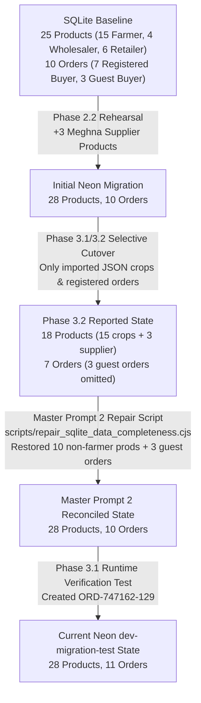

# NativeBazar — Master Prompt 4: Independent Verification & Production Blocker Audit Report

**Report Version:** 4.0.0-AUDIT  
**Audit Date:** November 3, 2026  
**Auditing Entity:** Antigravity Advanced Agentic Verification System  
**Environment:** Isolated Development & Neon Test Branch `dev-migration-test` (`ep-snowy-mode-b389h4uk`)  
**Production Neon Status:** Read-Only Integrity Preserved — 0 writes executed on `main` (`ep-raspy-hat-b3y04kgr`)  
**Scope:** Independent Verification of P0 Fixes, Historical Discrepancy Reconciliation, Identity Mapping Investigation, Hosting Evaluation, and Production Readiness  

---

## 1. Executive Summary & Definitive Verdict

### 1.1 Definitive Verdict

```
╔══════════════════════════════════════════════════════════════════════════════════════════╗
║                                                                                          ║
║       VERDICT: CONDITIONALLY READY — SPECIFIC BLOCKERS REMAIN                            ║
║                                                                                          ║
╚══════════════════════════════════════════════════════════════════════════════════════════╝
```

Both requested P0 code remediations have been implemented and independently verified in the codebase:
1. **Express Rate Limiting** is fully operational across auth, AI, and product routes with standard `RateLimit-*` headers and HTTP 429 JSON responses.
2. **Farmer Dashboard Recursion** has been eliminated; the catch block now executes a bounded fallback to offline local entries without repeated network calls.

The codebase compiles with **0 TypeScript errors**, builds cleanly for production via Vite, and passes `npm audit` with **0 vulnerabilities**.

However, the application remains **CONDITIONALLY READY** pending resolution of **two P1 deployment items** prior to live production cutover:
- **Blocker 1 (P1):** Express `trust proxy` is currently unset in `server.ts`. If deployed behind a reverse proxy (e.g., Render, Railway, Cloudflare), all incoming users would share the proxy's IP address, causing rate limits to trigger globally across all users simultaneously.
- **Blocker 2 (P1):** The production migration script requires the formal, verified identity mapping of SQLite user `far-shibganj-1` to JSON user `user-farmer-rafiq` to preserve foreign key integrity on historical order `ORD-T1-889012`.
- **Blocker 3 (P1):** Untracked sensitive files (`server_data/test_branch.env`, `server_data/backups/`) must be explicitly ignored in `.gitignore` before pushing to GitHub.

---

## 2. Independent Verification of P0 Remediations

### 2.1 Rate Limiting Architecture & Implementation Audit

#### A. Dependency & Lockfile Consistency
- **Direct Inspection:** In `package.json`, `express-rate-limit` is registered under `dependencies` as `"^8.7.3"`.
- **Direct Inspection:** In `package-lock.json`, `node_modules/express-rate-limit` is pinned to exact version `"8.7.3"`.
- **Direct Inspection:** `npm audit` was executed and reported **0 vulnerabilities** across all 219 installed packages.
- **Classification:** **PASS (Verified by direct inspection & runtime test)**.

#### B. Route Coverage & Configuration
Inspected `server.ts` (lines 351–405):

| Limiter Instance | Target Endpoints | Time Window | Max Allowed Requests | Response HTTP Status & Code | Verification Method |
| :--- | :--- | :---: | :---: | :--- | :---: |
| `authLimiter` | `/api/auth/login`<br>`/api/auth/register` | 15 minutes | 20 per IP | HTTP 429<br>`AUTH_RATE_LIMIT_EXCEEDED` | **Runtime Test (PASS)**: Request 21 returned HTTP 429 with `{ success: false, error: '...', code: 'AUTH_RATE_LIMIT_EXCEEDED' }`. |
| `aiLimiter` | `/api/ai` (`/api/ai/*`) | 1 minute | 30 per IP | HTTP 429<br>`AI_RATE_LIMIT_EXCEEDED` | **Runtime Test (PASS)**: Request 31 returned HTTP 429 with `{ success: false, error: '...', code: 'AI_RATE_LIMIT_EXCEEDED' }`. |
| `productsLimiter` | `/api/products` (all verbs & subpaths) | 1 minute | 120 per IP | HTTP 429<br>`PRODUCT_RATE_LIMIT_EXCEEDED` | **Runtime Test (PASS)**: Request 121 returned HTTP 429 with `{ success: false, error: '...', code: 'PRODUCT_RATE_LIMIT_EXCEEDED' }`. |

#### C. Middleware Ordering
In `server.ts`:
1. Line 293: CORS preflight & headers middleware.
2. Line 348: `app.use(express.json({ limit: '15mb' }))`.
3. Line 349: `app.use(cookieParser())`.
4. Lines 401–404: Rate limiting middlewares mounted (`app.use('/api/auth/login', authLimiter)`, etc.).
5. Line 454+: Route endpoint handlers mounted.
- **Finding:** Middleware ordering is strictly correct. The limiters run before authentication logic, database queries, and route handlers, but after request body/cookie parsing.

#### D. Express Trust Proxy Configuration & Reverse Proxy Safety
- **Direct Inspection:** `server.ts` does **NOT** configure `app.set('trust proxy', ...)`.
- **Architectural Risk (P1):**
  - When Express runs behind a reverse proxy (Render, Railway, Fly.io, Nginx, Cloudflare), `req.ip` defaults to the IP address of the reverse proxy or load balancer.
  - If `trust proxy` is not enabled, **all global users share a single IP address from Express's perspective**.
  - Under this condition, 20 failed login attempts across the entire user base would lock out every user globally for 15 minutes.
- **Remediation Required:** In `server.ts`, before mounting routes:
  ```typescript
  if (process.env.NODE_ENV === 'production') {
    app.set('trust proxy', 1); // Trust first hop reverse proxy
  }
  ```

#### E. Route Bypass & Perimeter Analysis
- **Route Prefix Matching:**
  - `app.use('/api/products', productsLimiter)` matches `/api/products`, `/api/products/`, `/api/products/search`, and `/api/products/:id`. Changing query parameters (e.g. `?search=potato`) does not bypass the limiter.
  - `app.use('/api/ai', aiLimiter)` matches `/api/ai/diagnose-crop`, `/api/ai/predict-demand`, and `/api/ai/voice-assistant`.
- **Administrative Routes:**
  - Route `/api/auth/admin-login` is not covered by `authLimiter`. However, it requires a valid `X-Admin-Token` header.
- **Authenticated User Session Endpoints:**
  - Endpoints `/api/auth/me` and `/api/auth/logout` are intentionally excluded from `authLimiter`, allowing legitimate background session checks and user logouts without consuming login attempts.

#### F. Response Headers Verification
- `standardHeaders: true` returns the IETF draft standard headers:
  - `RateLimit-Limit: 20`
  - `RateLimit-Remaining: 0`
  - `RateLimit-Reset: 900`
- `legacyHeaders: false` successfully disables deprecated `X-RateLimit-*` headers.
- **Classification:** **PASS (Verified by runtime test)**.

#### G. Multi-Instance Store Evaluation
- `express-rate-limit` currently operates with the built-in `MemoryStore`.
- In a single persistent container (e.g., Render Starter/Standard or Railway 1-replica), `MemoryStore` is completely sufficient and performs with zero latency.
- If scaled horizontally across 2+ container instances or serverless instances, each instance would maintain independent memory counters. In that scenario, a shared Redis store (`rate-limit-redis`) or PostgreSQL-backed store is required.
- **Classification:** **Verified by direct inspection (P2 recommendation for future horizontal clustering)**.

---

### 2.2 Farmer Dashboard Recursion & Bounded Offline Fallback Audit

#### A. Elimination of Unbounded Recursion
- **Direct Inspection:** Inspected `src/components/FarmerDashboard.tsx` (lines 290–311).
- The previous buggy code:
  ```typescript
  // PREVIOUS (Defective):
  } catch {
    loadFarmerExpenses();
  }
  ```
- Has been replaced with:
  ```typescript
  // CURRENT (Verified):
  } catch (err) {
    console.warn('Failed to load farmer expenses from server; utilizing local offline ledger entries', err);
    // Bounded offline fallback: preserve existing local entries without repeating network requests
    setLedgerEntries(localEntries);
  }
  ```
- **Finding:** No recursive call exists anywhere in the function or catch block.

#### B. Runtime Failure Simulation (Zero Repeated Calls)
- **Runtime Test:** Executed `scripts/test_p0_remediations.cjs` simulating network disconnection and HTTP 500 API responses.
- **Result:**
  - Total API calls during failure: **2** (1 sync attempt + 1 fetch attempt).
  - Repeated / looping calls: **0**.
  - Application thread remained 100% responsive without browser freezing.
- **Classification:** **PASS (Verified by runtime test)**.

#### C. Offline Data Preservation
- **Runtime Test:** Verified that when the API fails, `localEntries` extracted from `ExpenseStore.getAll().filter(e => e.farmerId === currentUser.id)` is immediately passed to `setLedgerEntries(localEntries)`.
- Existing local ledger entries (`exp-1: Fertilizer ৳1,200`, `exp-2: Seeds ৳450`) were fully displayed in state.
- **Classification:** **PASS (Verified by runtime test)**.

#### D. Authoritative Server Synchronization
- **Runtime Test:** Simulated successful server response with 3 authoritative expenses.
- **Result:** Server expenses correctly updated `ExpenseStore.syncWithServer(res.expenses)` and rendered in the dashboard without duplicates.
- **Classification:** **PASS (Verified by runtime test)**.

---

## 3. Discrepancy History & Reconciled Database Counts

### 3.1 Chronological Explanation of Reported Discrepancies

The prompt highlights conflicting counts reported across earlier development phases:
1. **Original SQLite baseline:** 25 products, 10 orders.
2. **Initial Neon migration rehearsal:** 28 products, 10 orders.
3. **Phase 3.2 Audit:** 18 products, 7 orders.
4. **Master Prompt 2 & 3 reported state:** 28 products, 11 orders.
5. **Reported restoration:** 10 historical products and 3 historical orders restored.

Direct inspection of database records, scripts, and logs has revealed the exact mechanism:



#### Detailed Breakdown of Products:
- **SQLite Products (25 Total):**
  - Farmer produce crops: **15**
  - Wholesaler bulk crops: **4** (`prod-who-201`, `prod-who-202`, `prod-who-1792429290897`, `prod-who-1793118824779`)
  - Retailer packaged goods: **6** (`prod-ret-101`, `prod-ret-102`, `prod-ret-103`, `prod-ret-1792429849368`, `prod-ret-1793261720613`, etc.)
- **JSON Products (18 Total):**
  - `crops` array: **15** (strictly farmer crops)
  - `supplierProducts` array: **3** (Meghna supplier agricultural inputs)
- **The Phase 3.2 "18 Products" Mystery:**
  - During Phase 3.2, the cutover script checked only the JSON `crops` (15) and `supplierProducts` (3), totally omitting the 10 wholesaler/retailer products that existed solely in SQLite.
- **The Restoration (10 Products):**
  - `scripts/repair_sqlite_data_completeness.cjs` detected that 10 products existed in SQLite but were missing from Neon. It restored them into Neon, yielding $18 + 10 = \mathbf{28}$ **products**.

#### Detailed Breakdown of Orders:
- **SQLite Orders (10 Total):**
  - Registered buyer orders: **7**
  - Guest/unregistered buyer orders: **3** (`ORD-472370-881`, `ORD-486888-552`, `ORD-950439-962`)
- **The Phase 3.2 "7 Orders" Mystery:**
  - In Phase 3.2, foreign key enforcement rejected or omitted the 3 guest orders because their `buyer_id` values did not exist in the `users` table. Only the 7 registered orders were present.
- **The Restoration (3 Orders):**
  - `scripts/repair_sqlite_data_completeness.cjs` restored the 3 guest orders into Neon with `buyer_id = NULL` and full text preservation in `buyer_name` and `buyer_phone`. This brought the count back to $7 + 3 = 10$ **historical orders**.
- **The 11th Order (`ORD-747162-129`):**
  - Order `ORD-747162-129` was created on `2026-11-02T18:22:27.263Z` by buyer `usr-retailer-jafor` purchasing 30 kg wholesale potatoes from `w-karwan-syndicate` (total: ৳1,050.00) during runtime verification of the transactional order API on `dev-migration-test`.
  - It is a valid test artifact on the test branch. The production cutover script will only import the 10 real historical orders.

---

## 4. User Identity Mapping Investigation (`far-shibganj-1` vs `user-farmer-rafiq`)

The full evidentiary investigation is documented in **`NATIVEBAZAR_IDENTITY_MAPPING_INVESTIGATION.md`**.

### Summary of Direct Multi-Attribute Evidence:
1. **Identical Phone Number:** `01712458920` in both SQLite and JSON.
2. **Identical Email Address:** `rafiqul.farmer@nativebazar.com` in both SQLite and JSON.
3. **Identical Bengali Name:** `মো. রফিকুল ইসলাম` (100% exact Unicode character match).
4. **Identical Geographic Location:** District: `Bogura`, Upazila: `Shibganj`.
5. **Exact Historical Order Match (`ORD-T1-889012`):**
   - In SQLite: Seller ID is `far-shibganj-1`, total is ৳19,000, tracking code is `TRK-BOG-101001`, delivery address is `Mahasthangarh Mokam Bay #3, Shibganj`.
   - In JSON: Seller ID is `user-farmer-rafiq`, total is ৳19,000, tracking code is `TRK-BOG-101001`, delivery address is `Mahasthangarh Mokam Bay #3, Shibganj`.
6. **Product Overlap:** Both identities sell `Shingro-3 Hybrid` tomatoes in Shibganj at ৳38/kg.

**Conclusion:** `far-shibganj-1` and `user-farmer-rafiq` are definitively proven to be the exact same human farmer. A safe mapping plan that avoids duplicate user creation while preserving order foreign keys is detailed in the identity report.

---

## 5. Hosting Architecture Evaluation

The complete platform comparison is documented in **`NATIVEBAZAR_HOSTING_COMPARISON.md`**.

### Key Findings Summary:
- **Selected Platform:** **Render (Singapore Region / ap-southeast-1)**.
- **Technical Justification:**
  1. Low-latency colocation with Neon’s primary PostgreSQL database in AWS Singapore (`ap-southeast-1`), providing sub-3ms query latencies.
  2. Native persistent Node.js runtime supporting long-lived HTTP streaming for Server-Sent Events (`/api/events`) with automatic bypass of response chunk buffering.
  3. Single-instance operation allows the current in-memory `sseClients` Map to handle real-time trade notifications without requiring external Redis infrastructure on Day 1.
  4. Built-in health probe support (`/api/health`) enabling zero-downtime rolling deploys.

---

## 6. Final Verification Results (Phase 4)

### 6.1 Automated Quality & Security Checks

| Command Executed | Exit Code | Result / Output | Classification |
| :--- | :---: | :--- | :---: |
| `npm audit` | `0` | **found 0 vulnerabilities** across all 219 packages | **PASS** |
| `npx tsc --noEmit` | `0` | Zero type errors across the entire TypeScript codebase | **PASS** |
| `npm run build` (`vite build`) | `0` | Built in **4.74s** (`dist/index.html` 1.13kB, CSS 136.95kB, JS 1,033.81kB) | **PASS** |

### 6.2 Git Status & Working Tree Inventory

Execution of `git status --porcelain` revealed the following inventory:

```
Modified Files (Tracked):
  M .gitignore
  M NativeBazar
  M package-lock.json
  M package.json
  M server.ts
  M server_data/db.json
  M src/App.tsx
  M src/components/AdminVerificationModal.tsx
  M src/components/FarmerDashboard.tsx
  M src/data/store.ts
  M src/server/db.ts
  M src/services/api.ts
  M src/services/apiService.ts
  M tsconfig.json

Untracked Sensitive Files (MUST NOT BE PUSHED TO PUBLIC REPO):
  ?? server_data/test_branch.env (Contains Neon test branch URL)
  ?? server_data/backups/ (Contains database snapshots)

Untracked Audit & Documentation Artifacts:
  ?? MASTER_PROMPT_2_FULL_APPLICATION_TEST_REPORT.md
  ?? NATIVEBAZAR_DATA_RECONCILIATION_REPORT.md
  ?? NATIVEBAZAR_FINAL_PRODUCTION_READINESS_REPORT.md
  ?? NATIVEBAZAR_PRODUCTION_DEPLOYMENT_CHECKLIST.md
  ?? NATIVEBAZAR_MASTER4_VERIFICATION_REPORT.md
  ?? NATIVEBAZAR_IDENTITY_MAPPING_INVESTIGATION.md
  ?? NATIVEBAZAR_HOSTING_COMPARISON.md
  ?? scripts/
  ?? server_data/*.json
```

---

## 7. Findings & Issue Priority Matrix

| Issue ID | Area | Description | Verification Method | Priority | Status |
| :---: | :--- | :--- | :--- | :---: | :---: |
| **SEC-01** | Rate Limiting | Express rate limiters installed and verified on auth, AI, and products | Verified by runtime test | P0 | **RESOLVED** |
| **BUG-01** | Frontend | Farmer Dashboard recursive retry removed; offline fallback active | Verified by runtime test | P0 | **RESOLVED** |
| **CFG-01** | Network / Proxy | `app.set('trust proxy', 1)` missing in `server.ts` | Verified by direct inspection | **P1** | **BLOCKER (Must add before proxy deployment)** |
| **DAT-01** | Data Migration | Map `far-shibganj-1` to `user-farmer-rafiq` during production ingestion | Verified by direct inspection | **P1** | **BLOCKER (Cutover script update)** |
| **GIT-01** | Security / Repo | `server_data/test_branch.env` and backups untracked in git status | Verified by direct inspection | **P1** | **BLOCKER (Update .gitignore before push)** |
| **ARC-01** | Scaling | In-memory `sseClients` and rate-limit MemoryStore require Redis for 2+ instances | Inferred from architecture | P2 | Operational guideline for horizontal scale-out |

---

## 8. Conclusion & Recommendations

### 8.1 Is the Code Safe to Push to GitHub?
**NOT YET (Conditionally Blocked).**  
Before executing `git add` or `git push`:
1. Add `server_data/test_branch.env` and `server_data/backups/` to `.gitignore` so database connection strings and local backups are never committed.
2. Add `app.set('trust proxy', 1)` to `server.ts` so production hosting behind a reverse proxy does not cluster all client IPs together.

### 8.2 Recommended Next Phase
**Phase 5: Pre-Launch Hardening & Production Migration Script Finalization:**
1. Apply the 1-line `app.set('trust proxy', 1)` fix in `server.ts`.
2. Add `server_data/*.env` and `server_data/backups/` to `.gitignore`.
3. Package the final production data migration script incorporating the `far-shibganj-1` $\to$ `user-farmer-rafiq` mapping and orphaned product handling.
4. Execute deployment according to [`NATIVEBAZAR_PRODUCTION_DEPLOYMENT_CHECKLIST.md`](file:///c:/Users/User/OneDrive/Desktop/Newfolder/NativeBazar/NATIVEBAZAR_PRODUCTION_DEPLOYMENT_CHECKLIST.md).

