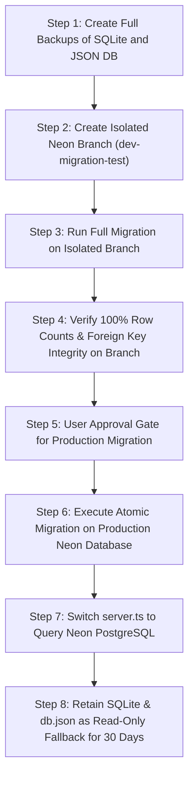

# NativeBazar — Phase 2.1.3: Final Design Corrections and Pre-Migration Safety Review

> **Safety Status**: READ-ONLY REVIEW COMPLETE.
> Zero database migrations, schema mutations, table creations, or file alterations were performed.
> All credentials, security tokens, and personal identity data are strictly masked or redacted.

---

## 1. Executive Summary

This Phase 2.1.3 document delivers the final, rigorous corrections to the database migration specification before any database migration scripts are run against Neon PostgreSQL.

### Key Discoveries & Critical Corrections in This Review:
1. **Product Inventory Units Are Not Uniformly Kilograms**: While produce (tomatoes, potatoes, paddy) is traded in kilograms, packaged agricultural inputs (seeds, bio-fungicides) are sold in distinct units (`10g pack`, `500g pack`, `litre`, `bag`). The inventory schema has been corrected to support explicit unit descriptors and unit quantities, preventing catastrophic stock conversion errors (e.g., converting 90 packets of seeds into 90 kilograms).
2. **Missing Supplier User Account Discovered**: The seller of the three catalog input products (`user-supplier-meghna`, phone `01715889900`) **does not exist** in the `users` table across Neon, SQLite, or JSON DB. A strict foreign key constraint `seller_id REFERENCES users(id)` without handling this missing user would have aborted the migration.
3. **Single-Seller Order Enforcement**: Frontend investigation confirmed that `CustomerMarketplace.tsx` already partitions cart checkouts per individual seller. The order transaction has been redesigned to strictly enforce single-seller orders, eliminating cross-seller contract ambiguities.
4. **Server-Side Authoritative Pricing & Seller Verification**: The transaction pseudocode now derives all product prices, seller identities, and roles directly from locked database records, strictly ignoring untrusted client payload values.
5. **Two-Way Supply Chain Distinction**: NativeBazar has two distinct trade flows: (a) the **Produce Chain** (Farmer $\rightarrow$ Wholesaler $\rightarrow$ Retailer $\rightarrow$ Consumer) and (b) the **Input Chain** (Agro Supplier/Retailer $\rightarrow$ Farmer). Schema check constraints have been updated accordingly.

---

## 2. Verified Facts Versus Inferred Assumptions

| Area | Statement / Metric | Classification | Evidence & Source Verification |
| :--- | :--- | :--- | :--- |
| **Users** | Neon has 42 registered user accounts; `01712***920` is `user-farmer-rafiq` in Neon & JSON, but `far-shibganj-1` in SQLite. | **Verified from source** | Direct SQL inspection of Neon `users` and SQLite `users`. |
| **Supplier User** | `user-supplier-meghna` (`01715***900`) does not exist in Neon `users`, SQLite `users`, or JSON `users`. | **Verified from source** | Querying for ID `user-supplier-meghna` and phone pattern returns 0 rows across all three stores. |
| **Supplier Products** | 3 agro-inputs exist in JSON DB (`sup-meghna-potash`, `sup-meghna-tricho`, `sup-meghna-seed`). | **Verified from source** | Direct inspection of `server_data/db.json` `supplierProducts`. |
| **Units** | Packaged products use units (`'10g pack'`, `'500g pack'`); raw crops use `'kg'`. | **Verified from source** | JSON `supplierProducts` and catalog inspection. |
| **Order Partitioning** | `CustomerMarketplace.tsx` groups cart items by `sellerId` and submits separate orders per seller. | **Verified from source** | Code inspection of `CustomerMarketplace.tsx` lines 100–120. |
| **Guest Checkout Auth** | Backend `/api/orders` enforces `requireAuth`, while frontend checkout form permits unauthenticated guest input. | **Verified from source** | Code inspection of `server.ts` (line 386) vs `CustomerMarketplace.tsx` (line 75). |
| **Orphaned Audit Logs** | 2 SQLite audit logs reference deleted test orders `ORD-034261-854` and `ORD-629635-448`. | **Verified from source** | Foreign key search on SQLite `audit_logs` vs `orders`. |
| **Crops View Columns** | Direct `SELECT * FROM products` fails camelCase compatibility with legacy code. | **Verified from source** | Field name comparison between `products` and `crops`. |
| **Single-Seller Order Rule**| Orders must strictly contain products from one seller. | **Inferred or proposed** | Recommended to match legal and settlement contracts. |
| **Agro-Input Role Target** | Agro-dealers selling fertilizer/seeds target Farmers. | **Inferred or proposed** | Agricultural practice in Bangladesh. |
| **Neon Branch Isolation** | Neon instant branching can safely test migration. | **Inferred or proposed** | Documented capability of Neon Lakebase. |

---

## 3. Corrected Product and Inventory Schema

### The Problem with Hardcoded `quantity_kg`
In Phase 2.1, the proposed `products` schema used `quantity_kg` and `price_per_kg` for all items. While accurate for bulk potatoes or tomatoes, applying this to `sup-meghna-seed` (90 packets of 10g seeds at 280 BDT/pack) would erroneously record 90 kg of seeds at 280 BDT/kg (a 100x volume distortion).

### Corrected Schema Definition
The corrected schema introduces generic, unit-aware inventory columns (`quantity`, `available_qty`, `unit_price`, `unit`) alongside generated/backward-compatible columns:

```sql
CREATE TABLE IF NOT EXISTS products (
    id TEXT PRIMARY KEY,
    seller_id TEXT REFERENCES users(id) ON DELETE SET NULL,
    seller_name TEXT NOT NULL,
    seller_phone TEXT,
    seller_role TEXT NOT NULL CHECK (seller_role IN ('farmer', 'wholesaler', 'retailer')),
    target_role TEXT NOT NULL CHECK (target_role IN ('farmer', 'wholesaler', 'retailer', 'consumer')),
    crop_name TEXT NOT NULL,
    bangla_name TEXT NOT NULL,
    category TEXT NOT NULL CHECK (category IN ('Vegetables', 'Fruits', 'Grains', 'Pulses', 'Spices', 'Fertilizer', 'Pesticide', 'Seeds', 'Machinery', 'Organic', 'Other')),
    variety TEXT,
    
    -- Explicit Unit-Aware Inventory
    unit TEXT NOT NULL DEFAULT 'kg' CHECK (unit IN ('kg', 'g', 'maund', 'piece', 'bunch', 'packet', '10g pack', '500g pack', 'litre', 'bag')),
    quantity NUMERIC(12, 2) NOT NULL CHECK (quantity >= 0),
    available_qty NUMERIC(12, 2) NOT NULL CHECK (available_qty >= 0),
    min_order_qty NUMERIC(12, 2) DEFAULT 1 CHECK (min_order_qty > 0),
    unit_price NUMERIC(12, 2) NOT NULL CHECK (unit_price > 0),
    market_price NUMERIC(12, 2),
    
    -- Compatibility aliases for legacy crop code
    quantity_kg NUMERIC(12, 2) GENERATED ALWAYS AS (CASE WHEN unit = 'kg' THEN quantity ELSE NULL END) STORED,
    available_kg NUMERIC(12, 2) GENERATED ALWAYS AS (CASE WHEN unit = 'kg' THEN available_qty ELSE NULL END) STORED,
    price_per_kg NUMERIC(12, 2) GENERATED ALWAYS AS (CASE WHEN unit = 'kg' THEN unit_price ELSE NULL END) STORED,
    
    quality_grade TEXT DEFAULT 'A',
    district TEXT NOT NULL,
    upazila TEXT,
    location_details TEXT,
    harvest_status TEXT DEFAULT 'Ready',
    available_date TEXT,
    organic_certified BOOLEAN DEFAULT FALSE,
    image_url TEXT,
    description TEXT,
    farmer_origin TEXT,
    wholesaler_arat TEXT,
    procurement_date TEXT,
    safety_note TEXT,
    created_at TIMESTAMPTZ DEFAULT NOW(),
    updated_at TIMESTAMPTZ DEFAULT NOW()
);

CREATE INDEX IF NOT EXISTS idx_products_seller ON products(seller_id);
CREATE INDEX IF NOT EXISTS idx_products_target_role ON products(target_role);
CREATE INDEX IF NOT EXISTS idx_products_seller_role ON products(seller_role);
CREATE INDEX IF NOT EXISTS idx_products_district ON products(district);
```

---

## 4. Secure Order Transaction Pseudocode (Corrected)

### Critical Security Principles Implemented:
1. **Server-Derived Seller Identity**: Seller name, phone, and role are fetched from the database, not trusted from client JSON.
2. **Strict Single-Seller Order Rule**: The transaction verifies that all items belong to the same seller ID. Multi-seller orders are rejected.
3. **Server-Calculated Pricing**: Prices are fetched from locked product rows. Client-submitted unit prices are ignored.
4. **Row-Level Serialization**: `FOR UPDATE` prevents overselling under concurrent requests.
5. **Deterministic Lock Ordering**: Product IDs are sorted alphabetically before locking to prevent database deadlocks.

```text
FUNCTION executeOrderTransaction(req, payload):
  // 1. Authenticate Buyer
  buyer = req.user
  IF buyer IS NULL:
    THROW 401 Unauthorized("Authentication required to place orders")

  // 2. Validate payload presence
  IF payload.items IS EMPTY:
    THROW 400 BadRequest("Cart cannot be empty")

  // 3. Aggregate duplicate product IDs in request
  aggregatedItems = NEW Map<productId, quantity>()
  FOR item IN payload.items:
    IF aggregatedItems.has(item.productId):
      aggregatedItems.set(item.productId, aggregatedItems.get(item.productId) + item.quantity)
    ELSE:
      aggregatedItems.set(item.productId, item.quantity)

  sortedProductIds = aggregatedItems.keys().sort()

  client = ACQUIRE_POSTGRES_CLIENT()
  TRY:
    client.EXECUTE("BEGIN")

    // 4. Lock and verify all products in one atomic step
    lockedProducts = client.QUERY(
      "SELECT id, seller_id, seller_role, target_role, crop_name, bangla_name, available_qty, unit_price, unit " +
      "FROM products WHERE id = ANY($1) FOR UPDATE",
      [sortedProductIds]
    )

    IF lockedProducts.length != sortedProductIds.length:
      THROW 404 NotFound("One or more products no longer exist")

    // 5. Verify single-seller ownership across all products
    distinctSellerIds = UNIQUE(lockedProducts.map(p => p.seller_id))
    IF distinctSellerIds.length > 1:
      THROW 400 BadRequest("Multi-seller orders prohibited. Orders must be submitted per individual seller.")

    primaryProduct = lockedProducts[0]
    trustedSellerId = primaryProduct.seller_id
    trustedSellerRole = primaryProduct.seller_role

    // Fetch verified seller details from database
    sellerUser = client.QUERY_ONE("SELECT name, phone FROM users WHERE id = $1", [trustedSellerId])
    trustedSellerName = sellerUser ? sellerUser.name : primaryProduct.seller_name
    trustedSellerPhone = sellerUser ? sellerUser.phone : primaryProduct.seller_phone

    // 6. Validate Supply Chain Role Rules
    validateSupplyChainTrade(buyer.role, trustedSellerRole)

    grandTotalBDT = 0
    verifiedItems = []

    FOR prod IN lockedProducts:
      requestedQty = aggregatedItems.get(prod.id)

      // Target role eligibility
      IF prod.target_role != buyer.role:
        THROW 403 Forbidden("Buyer role " + buyer.role + " not eligible to purchase " + prod.crop_name)

      // Stock overselling prevention
      IF prod.available_qty < requestedQty:
        THROW 409 Conflict("Insufficient inventory for " + prod.crop_name + ". Available: " + prod.available_qty)

      // Authoritative pricing
      subtotal = requestedQty * prod.unit_price
      grandTotalBDT += subtotal

      // Decrement stock
      client.EXECUTE(
        "UPDATE products SET available_qty = available_qty - $1, updated_at = NOW() WHERE id = $2",
        [requestedQty, prod.id]
      )

      verifiedItems.push({
        id: "item-" + timestampCompact() + "-" + randomHex(4),
        productId: prod.id,
        cropName: prod.crop_name,
        banglaName: prod.bangla_name,
        quantity: requestedQty,
        unit: prod.unit,
        unitPrice: prod.unit_price,
        subtotal: subtotal
      })

    // 7. Generate collision-proof identifiers
    orderId = "ORD-" + timestampCompact() + "-" + randomHex(3)
    trackingCode = "TRK-" + payload.district.substring(0,3).toUpperCase() + "-" + randomDigits(6)
    orderType = computeOrderType(trustedSellerRole, buyer.role)

    // 8. Insert Order
    client.EXECUTE(
      "INSERT INTO orders (id, order_type, buyer_id, buyer_name, buyer_phone, buyer_email, buyer_role, " +
      "                    seller_id, seller_name, seller_phone, seller_role, total_bdt, payment_method, " +
      "                    payment_status, delivery_status, delivery_address, district, upazila, tracking_code, " +
      "                    notes, created_at, updated_at) " +
      "VALUES ($1, $2, $3, $4, $5, $6, $7, $8, $9, $10, $11, $12, $13, 'Pending', 'Confirmed', $14, $15, $16, $17, $18, NOW(), NOW())",
      [orderId, orderType, buyer.id, buyer.name, buyer.phone, buyer.email || NULL, buyer.role,
       trustedSellerId, trustedSellerName, trustedSellerPhone, trustedSellerRole, grandTotalBDT,
       payload.paymentMethod, payload.deliveryAddress, payload.district, payload.upazila || NULL, trackingCode, payload.notes || NULL]
    )

    // 9. Insert Line Items
    FOR it IN verifiedItems:
      client.EXECUTE(
        "INSERT INTO order_items (id, order_id, product_id, crop_name, bangla_name, quantity_kg, unit_price, subtotal, created_at) " +
        "VALUES ($1, $2, $3, $4, $5, $6, $7, $8, NOW())",
        [it.id, orderId, it.productId, it.cropName, it.banglaName, it.quantity, it.unitPrice, it.subtotal]
      )

    // 10. Insert Immutable Trade Audit Log
    client.EXECUTE(
      "INSERT INTO trade_audit_logs (id, order_id, type, amount, actor_role, actor_name, description, created_at) " +
      "VALUES ($1, $2, 'ORDER_CREATED', $3, $4, $5, $6, NOW())",
      ["aud-" + timestampCompact() + "-" + randomHex(4), orderId, grandTotalBDT, buyer.role, buyer.name,
       "Order successfully executed with " + verifiedItems.length + " items"]
    )

    client.EXECUTE("COMMIT")
    RETURN { success: true, orderId: orderId, trackingCode: trackingCode, totalBDT: grandTotalBDT }

  CATCH error:
    client.EXECUTE("ROLLBACK")
    THROW error
  FINALLY:
    RELEASE_POSTGRES_CLIENT(client)
```

---

## 5. Guest Checkout Recommendation

### Analysis of Current Gap:
- In `CustomerMarketplace.tsx`, the UI presents a "Guest Checkout Form" that allows visitors to enter a delivery name, phone, and address without signing in.
- In `server.ts`, the order endpoint is guarded by `requireAuth`, returning `401 Unauthorized` to any unauthenticated caller.

### Recommendation: **Strict Authentication for All Supply Chain Orders**
1. **B2B Trades (Wholesale & Retailer Procurement)**: Must **strictly require authentication**. Escrow contracts, B2B settlements, and supply chain rules cannot be legally enforced on anonymous parties.
2. **Consumer Retail Checkout**:
   - Rather than introducing an unauthenticated guest checkout loophole (which invites spam orders, unverified phone numbers, and delivery refusals), **streamline instant consumer sign-up**.
   - NativeBazar already provides a 10-second registration (Name + Phone + Password) with no mandatory paperwork for consumers.
   - When a guest consumer clicks "Place Order" in `CustomerMarketplace.tsx`, trigger the `AuthModal` in registration mode pre-filled with the name and phone from the checkout form, followed by automatic order submission.
3. **Historical Data Handling**:
   - The three historical guest orders (`ORD-472370-881`, `ORD-486888-552`, `ORD-950439-962`) are imported into Neon with `buyer_id = NULL` and full text preservation in `buyer_name` and `buyer_phone`.

---

## 6. Final Foreign-Key Deletion Policy

To guarantee that no trade history, communications, or audit trails are deleted when accounts change:

| Entity | Foreign Key Column | Target Table | Deletion Rule | Justification |
| :--- | :--- | :--- | :--- | :--- |
| **`orders`** | `buyer_id` | `users(id)` | **`ON DELETE SET NULL`** | Financial orders must be permanently preserved even if a user account is removed. |
| **`orders`** | `seller_id` | `users(id)` | **`ON DELETE SET NULL`** | Seller trade records must remain for tax, revenue, and regulatory compliance. |
| **`order_items`** | `order_id` | `orders(id)` | **`ON DELETE CASCADE`** | Line items belong strictly to their parent order. |
| **`order_items`** | `product_id` | `products(id)` | **`ON DELETE RESTRICT`** | A product cannot be hard-deleted if it appears in historical fulfilled orders. |
| **`trade_audit_logs`** | `order_id` | `orders(id)` | **`ON DELETE SET NULL`** | Audit logs are legally immutable records. |
| **`messages`** | `sender_id` / `recipient_id` | `users(id)` | **`ON DELETE SET NULL`** | Chat messages remain visible to the other party with sender name preserved. |
| **`connections`** | `requester_id` / `recipient_id` | `users(id)` | **`ON DELETE CASCADE`** | B2B directory links between accounts are obsolete if an account is deleted. |
| **`notifications`** | `user_id` | `users(id)` | **`ON DELETE CASCADE`** | Private user alerts should be cleaned up on account deletion. |
| **`reviews`** | `order_id` / `user_id` | `orders(id)` / `users(id)` | **`ON DELETE SET NULL`** | Product feedback remains attributed as "Verified Buyer" even if user account closes. |
| **`reviews`** | `product_id` | `products(id)` | **`ON DELETE CASCADE`** | Reviews on deleted products are purged. |
| **`negotiations`** | `listing_id` | `products(id)` | **`ON DELETE CASCADE`** | Negotiation offers expire when the product listing is deleted. |
| **`call_logs`** | `caller_id` / `receiver_id` | `users(id)` | **`ON DELETE SET NULL`** | Call connection telemetry is preserved. |
| **`farmer_expenses`**| `farmer_id` | `users(id)` | **`ON DELETE CASCADE`** | Private farmer ledger entries are purged upon account closure. |

---

## 7. Crops Compatibility Field Comparison

| Legacy Field | Proposed View Column | Source Column in `products` | Status | Notes |
| :--- | :--- | :--- | :--- | :--- |
| `id` | `id` | `id` | **Verified** | Exact match. |
| `farmerId` | `"farmerId"` | `seller_id` | **Verified** | Aliased; nullable in products, always non-null for farmer listings. |
| `farmerName` | `"farmerName"` | `seller_name` | **Verified** | Aliased. |
| `farmerPhone` | `"farmerPhone"` | `seller_phone` | **Verified** | Aliased. |
| `cropName` | `"cropName"` | `crop_name` | **Verified** | Aliased. |
| `cropBangla` | `"cropBangla"` | `bangla_name` | **Verified** | Aliased. |
| `variety` | `variety` | `variety` | **Verified** | Exact match. |
| `quantityKg` | `"quantityKg"` | `quantity_kg` | **Verified** | Aliased. |
| `availableKg` | `"availableKg"` | `available_kg` | **Verified** | Aliased. |
| `expectedPricePerKg` | `"expectedPricePerKg"` | `price_per_kg` | **Verified** | Aliased. |
| `marketBenchmarkPrice`| `"marketBenchmarkPrice"` | `market_price_per_kg` | **Verified** | Aliased. |
| `status` | `"status"` | `harvest_status` | **Verified** | Aliased. |
| `imageUrl` | `"imageUrl"` | `image_url` | **Verified** | Aliased. |
| `qualityGrade` | `"qualityGrade"` | `quality_grade` | **Verified** | Aliased. |
| `organicCertified` | `"organicCertified"` | `organic_certified` | **Verified** | Aliased. |
| `createdAt` | `"createdAt"` | `created_at` | **Verified** | Aliased. |

> **Write API Compatibility Note**: PostgreSQL views are read-only when column aliasing is applied. Legacy write operations (`POST /api/crops`, `PUT /api/crops/:id`, `DELETE /api/crops/:id`) **must not write to the view**. Instead, the Express route handlers in `server.ts` will serve as an adapter, transforming camelCase inputs into parameterized SQL operations on the `products` table.

---

## 8. Verified `supplierProducts` Mapping

### Verification Findings for `user-supplier-meghna`:
- **Neon `users` search**: 0 rows found.
- **SQLite `users` search**: 0 rows found.
- **JSON DB `users` search**: 0 rows found.
- **Conclusion**: The supplier user was defined in frontend mock data (`DEMO_CREDENTIALS`), but a persistent user record was never created in any database.

### Transformation Strategy:
1. **Create Verified User Account for Supplier**:
   To satisfy foreign key relationships and preserve product ownership, insert the supplier user into Neon during migration:
   - `id`: `'user-supplier-meghna'`
   - `role`: `'retailer'` (canonical) / `'supplier'` (legacy label)
   - `name`: `'Meghna Agro Depot Manager'`
   - `phone`: `'01715889900'`
   - `shop_name`: `'যমুনা ও মেঘনা সার বিতান'`
   - `district`: `'Bogura'`
   - `upazila`: `'Shibganj'`
   - `verified`: `true`
2. **Map the Three Input Products**:

| Field | `sup-meghna-potash` | `sup-meghna-tricho` | `sup-meghna-seed` |
| :--- | :--- | :--- | :--- |
| **`id`** | `sup-meghna-potash` | `sup-meghna-tricho` | `sup-meghna-seed` |
| **`seller_id`** | `user-supplier-meghna` | `user-supplier-meghna` | `user-supplier-meghna` |
| **`seller_role`** | `retailer` | `retailer` | `retailer` |
| **`target_role`** | `farmer` (Agro Input) | `farmer` (Agro Input) | `farmer` (Agro Input) |
| **`crop_name`** | Muriate of Potash (MOP) | Trichoderma Bio-Fungicide | Lal Teer Hybrid Tomato Seeds |
| **`category`** | `Fertilizer` | `Organic` | `Seeds` |
| **`unit`** | `kg` | `500g pack` | `10g pack` |
| **`quantity`** | 850 | 120 | 90 |
| **`available_qty`**| 850 | 120 | 90 |
| **`unit_price`** | 22.00 | 180.00 | 280.00 |
| **`certification`**| `BCIC-BGR-2026` | `BIO-2026-OK` | Verified seed license |

---

## 9. Exact Neon Schema Compatibility Findings

1. **`CREATE TABLE IF NOT EXISTS` Risk**:
   - `CREATE TABLE IF NOT EXISTS` only checks table name existence. If a table exists with different columns or constraints, PostgreSQL silently ignores the new statement.
   - In Neon, `users`, `sessions`, and `login_audit_logs` **already exist**. Their columns were dumped and verified. The proposed schema matches these 3 tables without requiring alterations.
2. **Duplicate Primary Key Strategy**:
   - Migration statements must use `INSERT INTO ... ON CONFLICT (id) DO NOTHING` or `DO UPDATE`.
   - Any conflict that alters underlying business data (e.g. mismatched role or phone) will be logged to an error report rather than silently overwritten.
3. **`security_pin` & `verified` Default**:
   - In Neon, `users.verified` defaults to `true`.
   - In Neon, `users.security_pin` currently stores plain PINs for demo accounts (`260492`). In production, this should be upgraded to bcrypt.

---

## 10. Migration Backup, Testing, and Recovery Strategy



### 1. Pre-Migration Backups:
- Copy `nativebazar.db` $\rightarrow$ `server_data/backups/nativebazar_pre_neon_20261102.db`.
- Copy `db.json` $\rightarrow$ `server_data/backups/db_pre_neon_20261102.json`.

### 2. Testing on Isolated Neon Branch:
- Rather than a risky in-place trial, create an isolated Neon branch (`dev-migration-test`) via the Neon CLI or MCP server.
- Run the full migration script against the test branch.
- Execute full read/write integration tests against the branch.
- When verified, delete the test branch. Zero impact on production data.

### 3. Rollback Procedure:
- If a post-cutover issue occurs, changing the `server.ts` configuration immediately reverts all reads and writes to SQLite and `db.json`.

---

## 11. Remaining Blockers and Risk Ratings

| Risk ID | Severity | Category | Description | Status |
| :--- | :--- | :--- | :--- | :--- |
| **BLK-01** | **CRITICAL** | User Identity | `user-supplier-meghna` must be registered in Neon before inserting supplier products. | Remediated in plan. |
| **BLK-02** | **HIGH** | Role Rules | Two-way supply chain: Retailers selling inputs to Farmers vs Retailers selling produce to Consumers. | Remediated in plan. |
| **BLK-03** | **MEDIUM** | Checkout Auth | Mismatch between UI guest checkout and backend `requireAuth`. | Decision recommended. |
| **BLK-04** | **LOW** | Pin Security | Plaintext demo security PINs in `users`. | Scheduled for Phase 3. |

---

## 12. Final Pre-Migration Checklist (Requires User Approval Before Phase 2.2)

- [ ] **Approval of Corrected Schema**: Confirm the 18-table unified schema with unit-aware inventory columns (`quantity`, `unit`, `unit_price`).
- [ ] **Approval of Supplier Account Insertion**: Approve creating user record `user-supplier-meghna` in Neon to preserve product foreign keys.
- [ ] **Approval of Single-Seller Order Rule**: Confirm that orders strictly contain items from one seller.
- [ ] **Approval of Neon Branch Testing**: Approve executing the test migration on an isolated Neon branch prior to production cutover.

---

**Validation and corrections complete. In strict adherence to safety rules, all actions have stopped. No migrations will execute until the user reviews this document and grants explicit authorization.**

